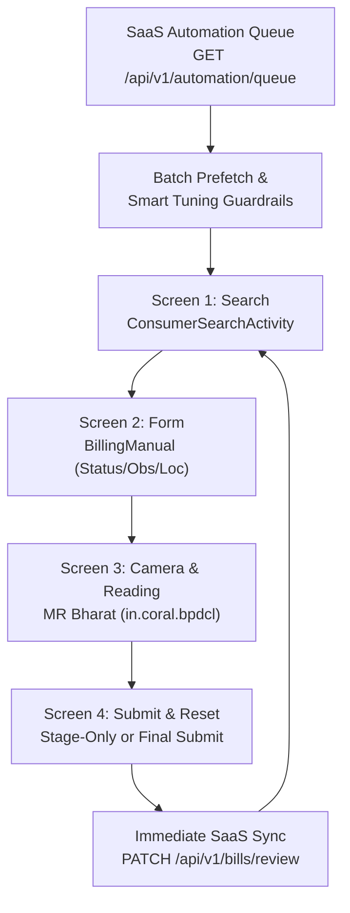

# Meter Billing Automator (`smart_engine`)

High-performance, event-driven Android automation and batch billing engine for NBPDCL (North Bihar Power Distribution Company Ltd) meter billing workflows.

Integrated with the [Meter Billing Management SaaS](https://meterreaing.nexgentech.site) to provide automated consumer queue resolution, smart average tuning, OCR validation override, camera capture, and real-time ledger synchronization.

---

## Architecture Overview

The system uses a modular, 4-stage pipeline orchestrated by `SmartRunner`:



### Modular Screen Controllers (`smart_engine/`)

1. **Screen 1 (`Screen1Search`)**:
   * Direct `am start` to `in.phoenix.bpdcl.ConsumerSearchActivity`.
   * Input clearing and high-speed typing with zero post-type sleep.
   * Dynamic event polling for `BillingManual` activity or invalid consumer alert dialogs.

2. **Screen 2 (`Screen2Form`)**:
   * Closed-loop verification of form dropdowns: Present Status (`NORMAL`/`DEFECTIVE`), Site Observation (`OK`), Meter Location (`Inside`).
   * Smart pre-fill fastpath bypass when fields already contain target values.
   * Native scroll and dynamic bound calculation to launch MR Bharat via `KwhCaptureButton`.

3. **Screen 3 (`Screen3Camera`)**:
   * MR Bharat viewfinder control (`in.coral.bpdcl.ScanMeterActivity` / `.MeterReadingActivity`).
   * OCR pre-clearing: full backspace clean before injecting pre-calculated / tuned kWh reading.
   * Automated revalidation override flow: handles "Readings are correct" remark and dialog confirmations ("OK", "Submit", "Yes", "Confirm").

4. **Screen 4 (`Screen4Submit`)**:
   * Stage-Only Mode (Safe Mode): Leaves bill validated on device for human review.
   * Final Submit Mode: Confirms NBPDCL bill generation dialog and returns cleanly to search.

---

## Features

* **Smart Average Tuning**:
  * Clamps consumption to minimum floor (default $\ge 125\text{ kWh}$ or custom `--min-floor`), maximum ceiling, and percentage adjustments.
  * Preserves individual consumer database overrides while applying MRU-wide batch guardrails.
* **Immediate Per-Consumer SaaS Sync**:
  * Updates the central SaaS billing database instantly upon each consumer's bill generation.
  * Protects against progress loss if batch runs are cancelled or interrupted.
* **Non-Blocking Watchdog Waiters**:
  * UI state transitions are detected dynamically without brittle static sleep timers.
  * Resilient against device alerts and network delays.

---

## Setup & Installation

### Prerequisites
* Python 3.10+
* Android device running NBPDCL Suvidha & MR Bharat apps with USB debugging enabled over ADB
* Network connectivity to the SaaS API (`https://meterreaing.nexgentech.site/api/v1`)

### 1. Clone & Install Dependencies
```bash
git clone https://github.com/shamim244/meter-billing-automator.git
cd meter-billing-automator
pip install -r requirements.txt
```

*(If `requirements.txt` is not installed, the core libraries are `uiautomator2`, `requests`, and `python-dotenv`.)*

### 2. Configure Environment
Copy `.env.example` to `.env` and fill in your credentials:
```bash
cp .env.example .env
```

```env
NBPDCL_API_KEY=nbp_live_your_token_here
NBPDCL_API_BASE=https://meterreaing.nexgentech.site/api/v1
NBPDCL_AUTH_MODE=bearer
NBPDCL_MRU_CODE=8
NBPDCL_CYCLE=OCT-2026
NBPDCL_MIN_FLOOR=125
ADB_DEVICE_SERIAL=192.168.9.40:5555
```

---

## Usage

### Preview Queue (Dry-Run Mode)
Preview suggested readings and tuning calculations without hardware interaction:
```powershell
python -u smart_engine/runner.py --mru 8 --cycle OCT-2026 --limit 5 --apply-tuning --dry-run
```

### Stage-Only Run (Safe Mode)
Fills the form, enters the reading, and saves the bill on the device without final submission:
```powershell
python -u smart_engine/runner.py --mru 8 --cycle OCT-2026 --limit 5 --apply-tuning
```

### Final Bill Submission
Executes complete automated bill generation and immediately syncs the SaaS ledger:
```powershell
python -u smart_engine/runner.py --mru 8 --cycle OCT-2026 --limit 5 --apply-tuning --final-submit
```

### Target Specific Consumer
Process a single account number:
```powershell
python -u smart_engine/runner.py --ca 10230062240 --apply-tuning --final-submit
```

---

## Testing

Run unit test suites covering search, form automation, camera, and runner components:
```powershell
python -m unittest discover tests
```

---

## License
Proprietary & Confidential - For NBPDCL meter operations and authorized field agents.
